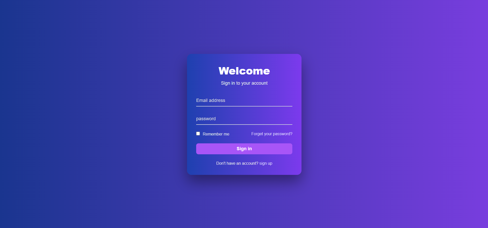

# Purple Log-in

A purple-themed log-in page built with **HTML and CSS**. This is a front-end UI practice project focused on form layout and styling.

**[Live Demo](https://sadra00sa.github.io/Purple-Log-in/)**

<!-- Add a screenshot: save it as screenshot.png in the repo root and keep the line below -->


## Features

- Welcome heading with a "Sign in to your account" subtitle
- Email address and password fields
- "Remember me" checkbox
- "Forget your password?" link
- Sign-in button
- "Don't have an account? Sign up" link for new users

## Built With

- HTML5
- CSS3

## Getting Started

No installation or build step is needed.

```bash
git clone https://github.com/sadra00sa/Purple-Log-in.git
cd Purple-Log-in
```

Then open `index.html` in your browser.

## Notes

This project is a static interface only. It has no back end, so the form does not authenticate users, and the "Forget your password?" and "Sign up" links are placeholders.

## What I Practiced

- Structuring a form with semantic HTML
- Aligning and styling inputs, labels, checkboxes and buttons with CSS
- Building a simple color theme around a single main color

## Author

**Sadra Salehi**
GitHub: [@sadra00sa](https://github.com/sadra00sa)
